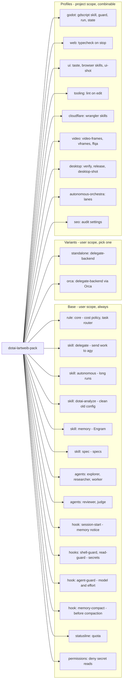

# dotai-lartweib-pack

A pack for [dotai](https://github.com/Lartweib/dotai), the cross-harness configuration engine for AI coding agents. A pack is an opinionated setup in dotai's format, rendered by the engine into each harness: think LazyVim on top of Neovim.

This one ships a base with a cost policy and guard hooks, two variants for how work is delegated, and nine project profiles. It targets **Claude Code** and **Google Antigravity CLI (agy)**; **OpenCode** is optional and a preview, managed only when you ask for it.

## Install

You need [dotai](https://github.com/Lartweib/dotai#install), git 2.41 or later, Node.js 22 or later (every hook and tool is a Node script), and the harnesses you use.

```sh
# Fetch the pack at a release tag
dotai pack add https://github.com/Lartweib/dotai-lartweib-pack --ref v0.1.0

# User scope: the base and one variant (see the plan first, then run it again without --dry-run)
dotai install ~/.dotai/packs/github.com/lartweib/dotai-lartweib-pack --variant standalone --dry-run

# Project scope, from inside a project: one or more profiles
dotai apply --profile web,ui
```

You don't need to pick profiles by hand. dotai's `dotai-profiles` skill proposes them from the files the project tracks, and its session-start hook offers it once per project. `dotai restore` undoes an install, `dotai restore --project` undoes an apply, and `dotai pack update github.com/lartweib/dotai-lartweib-pack` shows what changed before it updates.

## What it adds



## Base

Installed once per machine, at user scope, in every harness the pack manages.

- **Core rule**: the cost policy (which model and effort for which task), a lightweight task router, and short working rules.
- **Skills**: `delegate` (hand work to another harness with an explicit model and effort), `autonomous` (plan an unattended run), `memory` (Engram through its CLI), `spec`, and `dotai-analyze` (clean up clashes with what a project already carries).
- **Subagents**: `explorer`, `researcher`, `worker`, `reviewer`, `judge`, each with its model and effort declared.
- **Hooks**: `shell-guard` asks before destructive commands and blocks reads of secret paths; `read-guard` caps large artifact reads; `agent-guard` requires a model and a declared effort on every subagent launch; `session-start` and `memory-compact` wire Engram memory.
- **Statusline** for Claude Code and agy, with quota and delegation state.
- **Permissions** that deny reads of common secrets (`.env` files, keys, cloud credentials).

## Variants

| Variant | When | Adds |
|---|---|---|
| `standalone` (default) | No Orca | `delegate-backend`: launches the delegated agent itself and keeps a launch log |
| `orca` | The `orca` command is on `PATH` | `delegate-backend` that runs each delegation in an Orca terminal and reads its result |

## Profiles

Flat and combinable; each one is applied per project.

| Profile | When | Main items |
|---|---|---|
| `godot` | Godot 4 games in GDScript | `godot-gdscript` skill, `godot-guard` shell hook, `godot-run`, `godot-state` |
| `autonomous-orchestra` | Long unattended runs on any stack | `autonomous-orchestra` skill, `orchestra-lanes` worktree tool |
| `web` | Astro, Next.js, SvelteKit or Vite apps | `web` rule, `web-check` typecheck on stop |
| `ui` | Any project with a UI | `lartweib-taste` and `browser-tooling` skills, `ui-shot` capture |
| `seo` | An SEO audit of a public site | Read-size paths for audit outputs; the suite is a manual install |
| `cloudflare` | Workers and Pages with wrangler | `cloudflare` rule, `wrangler` and `workers-best-practices` skills (vendored, with their licenses) |
| `video` | Making and reviewing video | `video` rule, `video-frames` skill, `vframes`, `ffqa` |
| `tooling` | Go or Python CLIs, JS tool workspaces | `tooling` rule, `tooling-check` lint on edit |
| `desktop` | Electron apps | `desktop` rule, `desktop-verify` and `desktop-release` skills, `desktop-shot` |

Each profile's README lists its external items (tools you install yourself) and what was measured.

## Repository layout

| Path | What |
|---|---|
| `dotai.yaml` | The manifest: version, pinned rulesync, harnesses, profiles, variants |
| `base/` | The base layer: `.rulesync/` (rules, skills, subagents, hooks, permissions) and `dotai/` (settings, tools) |
| `variants/` | `standalone/` and `orca/` |
| `profiles/` | One directory per profile, same shape as the base |
| `scripts/` | `check.mjs`, the checks run before a release |
| `docs/` | [Design](docs/DESIGN.md), [runtime](docs/RUNTIME.md), [decision records](docs/decisions/README.md), [open questions](docs/OPEN-QUESTIONS.md) |

## Versioning and releases

Releases are SemVer tags `vX.Y.Z` on `main`, and that tag is what you pin with `--ref`. The tag always equals `version` in `dotai.yaml`. Release notes are generated from the Conventional Commits. The pack stays on `0.x` until the engine features it waits for are released; then comes `v1.0.0`. dotai identifies a git pack by its repository, not by the manifest `name` ([decision 0048](docs/decisions/0048-versioning-and-release.md)).

## Development

- Tests: `node --test --test-concurrency=2` (Node's built-in runner, no dependencies).
- Pack check: `dotai validate . --variant standalone` and `--variant orca`.
- Before tagging, run `node scripts/check.mjs`: tests, `dotai validate` for each variant (`DOTAI` names the binary, else `dotai` on `PATH`), the tree check dotai runs on `pack add`, a privacy guard over tracked files, and the tag against `dotai.yaml`. CI runs the same script.
