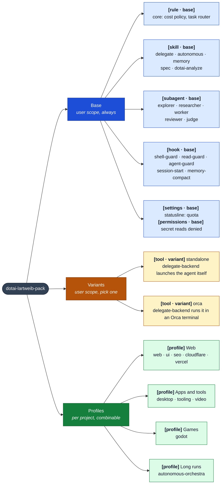
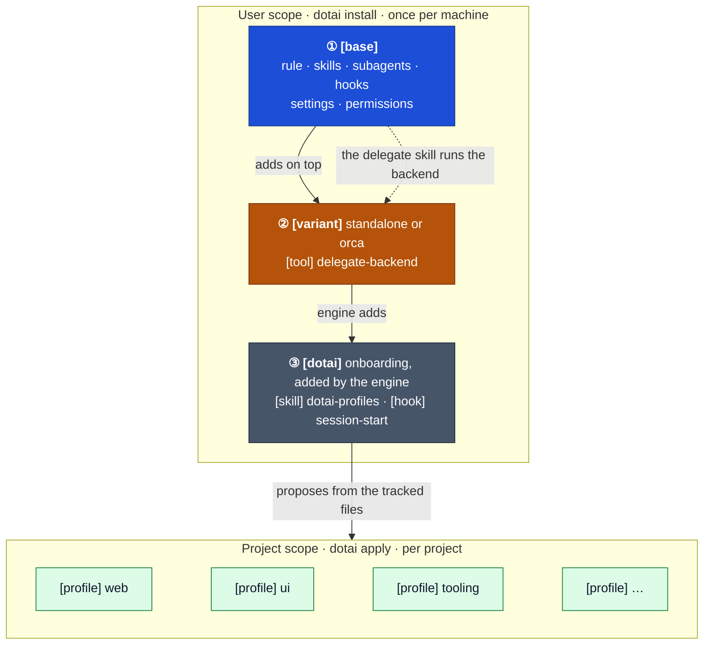
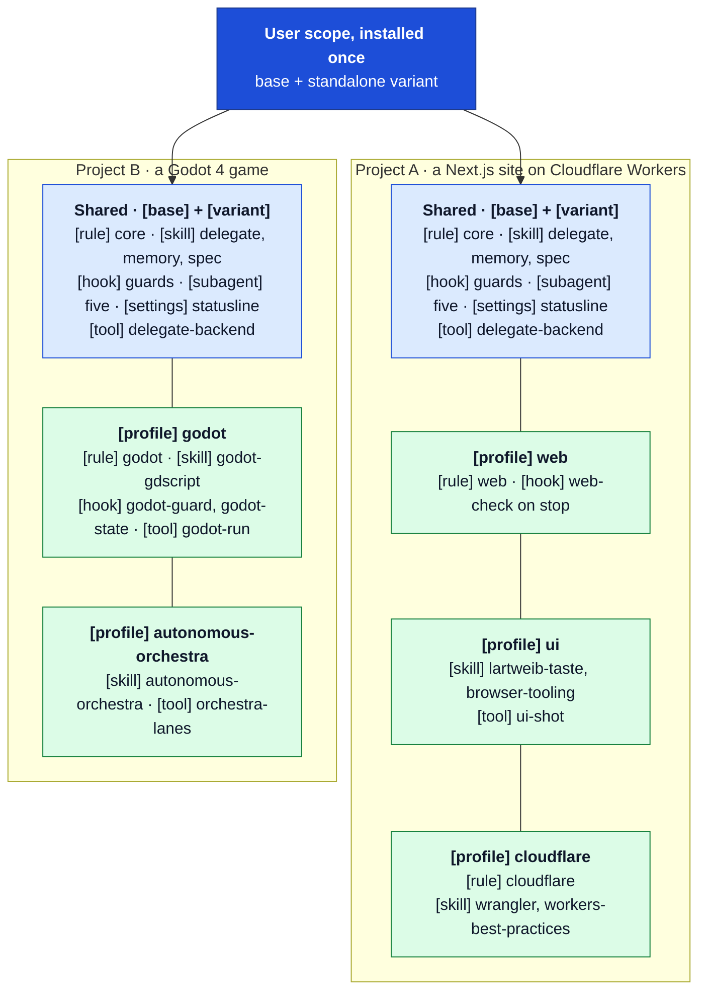

# dotai-lartweib-pack

[](https://github.com/lartweib/dotai)

A cost-aware setup for AI coding agents: guard hooks, cheap delegation, CLI-based memory and profiles applied per project.

It is a pack for [dotai](https://github.com/Lartweib/dotai), the cross-harness configuration engine, for **Claude Code** and **Google Antigravity CLI (agy)**, with **OpenCode** as a preview. Think LazyVim on top of Neovim: dotai is the neutral engine, this pack the opinionated distribution, with a base, two variants and ten project profiles.

## Highlights

- **A cost policy in the core rule**: which model and effort for which task, a lightweight task router, and a capped always-on budget ([decision 0046](docs/decisions/0046-split-always-on-budget.md)).
- **Guard hooks**: `shell-guard` asks before destructive commands and blocks reads of secret paths, `read-guard` caps large artifact reads, and `agent-guard` requires a model and a declared effort on every subagent launch.
- **Delegation across harnesses**: the `delegate` skill hands research, audits or bulk mechanical work from your primary harness to the other one (Claude Code to agy by default, or agy to Claude Code) with an explicit model and effort, within quota. It runs one way only: the secondary never delegates back, so the primary's quota is never spent on its behalf ([decisions 0009](docs/decisions/0009-directional-delegation-with-quota-config.md), [0050](docs/decisions/0050-delegation-direction-as-user-configuration.md)). Run directly (`standalone`) or in an Orca terminal (`orca`).
- **Engram memory through its CLI**: a `memory` skill plus `session-start` and `memory-compact` hooks, with no MCP server ([decision 0041](docs/decisions/0041-engram-via-cli-and-hooks.md)).
- **Profiles detected per project**: dotai's `dotai-profiles` skill proposes profiles from the files the project tracks, and its session-start hook offers it once per project.
- **No MCP by default**: scripts and CLIs first; the pack ships no MCP servers.
- **Secrets denied**: permissions deny reads of `.env` files, keys and cloud credentials.

## Context budget

Every always-on token is paid on each request, by the main thread and by every subagent. The pack sets limits so it does not load context nobody asked for. Token counts are real tokens as the harness bills them.

- **Caps** ([decision 0046](docs/decisions/0046-split-always-on-budget.md)): base plus profile rules ≤ 2,500; skill and agent descriptions ≤ ~2,000, and ≤ ~100 per entry; total warns at 4,000 and fails at 5,000.
- **What the base adds** ([decision 0008](docs/decisions/0008-always-on-budget-values.md)): +1,759 in Claude Code and +1,630 in agy, on top of each harness's own floor (~23k for Claude Code's system prompt and built-in tools, ~7.2k for agy) that no pack controls.
- **Skills load on demand**: only their descriptions are always on; the body is read when a task needs it.
- **CLIs instead of MCP servers**, per choice:

| Need | The pack uses | Instead of | Source |
|---|---|---|---|
| Memory | Engram through its CLI and a `memory` skill (~50 listed) | Engram's MCP (~1.9k per session) | [0041](docs/decisions/0041-engram-via-cli-and-hooks.md) |
| Browser, interactive | agent-browser (~290 of output for a 10-step flow) | Playwright MCP (~5.3k of schemas per session) | [0011](docs/decisions/0011-browser-tooling-split.md) |
| GitHub | `gh` (~0 fixed) | GitHub MCP (11–55k of schemas, vendor-reported) | [DESIGN P1](docs/DESIGN.md#2-cross-cutting-principles), [0014](docs/decisions/0014-base-principles-scripts-hooks-deny.md) |

Playwright itself stays: the `ui` profile uses Playwright scripts or `@playwright/test` for repeatable, bulk or measured browser work, and agent-browser for interactive exploration ([0011](docs/decisions/0011-browser-tooling-split.md)). Only the Playwright MCP is left out.

## Install

Requirements: [dotai](https://github.com/Lartweib/dotai#install), git 2.41 or later, Node.js 22 or later (every hook and tool is a Node script), and the harnesses you use.

```sh
dotai pack add https://github.com/Lartweib/dotai-lartweib-pack --ref v0.1.0
dotai install ~/.dotai/packs/github.com/lartweib/dotai-lartweib-pack --variant standalone
dotai apply --profile web,ui   # inside a project
```

> [!NOTE]
> No release is tagged yet. `--ref v0.1.0` applies once that tag exists; until then, leave out `--ref` and dotai fetches the default branch.

The pack requires no harness (`requires: []` in `dotai.yaml`): it installs on Claude Code, agy or both, and delegation needs both. The delegating harness is `primary` in `~/.dotai/packs/dotai-lartweib-pack/delegate.yaml` (`claudecode` when unset); an agy-main user sets:

```yaml
delegate:
  primary: agy
```

OpenCode is opt-in: pass `--harness claudecode,antigravity-cli,opencode` to `dotai install`. Add `--dry-run` to any `install` or `apply` to see the plan first. Versioning and pinning are in [Versioning and releases](#versioning-and-releases).

## What you get

The manifest, `dotai.yaml`, lists each profile with the description and hints the `dotai-profiles` skill uses to propose it:

```yaml
profiles:
  godot:
    path: profiles/godot
    description: Godot 4 games in GDScript (project.godot, .gd scripts, .tscn scenes).
    hints: [project.godot, export_presets.cfg]
```

A trimmed `dotai install . --variant standalone --dry-run` on a machine with Claude Code and agy and no previous install:

```text
Install plan · dotai-lartweib-pack 0.1.0 · variant standalone · mode isolated
root: ~/.dotai/isolated
note: the preview harness opencode is not managed unless you choose it: [...]; pass --harness opencode to manage it

claudecode · partial isolation · needs a new login
antigravity-cli · partial isolation · keeps your login
opencode · preview, not managed

claudecode
  create     ~/.dotai/isolated/claude/CLAUDE.md
  create     ~/.dotai/isolated/claude/agents/explorer.md
  [...]
  create     ~/.dotai/isolated/claude/settings.json
             keys: create $schema, create claudeMdExcludes, [...], create hooks, create permissions, create statusLine
  [...]

tools
  create     ~/.dotai/tools/delegate-backend.mjs
  [...]
  create     ~/.dotai/tools/shell-guard.mjs
  [...]

57 create, 0 replace, 0 remove, 0 unchanged · dry run, nothing was written
```



## Everyday commands

| Command | What it does |
|---|---|
| `dotai pack add <github-url> [--ref r]` | Fetch the pack into `~/.dotai/packs/` |
| `dotai install <pack> --variant v --dry-run` | Show the user-scope plan (base and variant); writes nothing |
| `dotai apply --profile a,b` | Apply profiles to the project in the current directory |
| `dotai restore` | Undo an install from its backup |
| `dotai restore --project` | Undo an apply in the current project |
| `dotai pack update github.com/lartweib/dotai-lartweib-pack` | Show what changed, then update the pack |

The full CLI is in dotai's [CLI-JSON](https://github.com/Lartweib/dotai/blob/main/docs/CLI-JSON.md).

## How the layers stack

dotai merges the layers in a fixed order: the base, then the variant on top of it, then dotai's own onboarding, all at user scope; profiles come later, per project, as peers. Every step only adds: a later layer cannot silently replace what an earlier one ships.



| What | How layers combine |
|---|---|
| Skills, subagents, rules, MCP servers | One name, one owner. A same name in two layers is an error unless the later one declares an override; a profile can never reuse a base or variant name. |
| Hooks and permissions | Union in layer order: a later layer appends entries, never removes or changes one. |
| Settings (statusline, env) | A later layer replaces a value only with a declared override; two profiles setting the same key is an error. |
| Tools | The base and the variant share `~/.dotai/tools/`, so the same file in both is an error; profiles install to the project's `.dotai/tools/`. |
| Root rule | Only the base provides it. |

User and project scope write separate files; where both set something, the harness decides which wins (Claude Code, for one, prefers the project).

### Two projects, one install

The user scope is installed once and every project gets it; what changes from one project to the next is only the profiles applied there.



Blue is the same in both projects; green is what each project chose. Each box is tagged with the layer that adds it (`[base]`, `[variant]`, `[profile]`, `[dotai]` for the engine's own items) and each item with its kind (`[rule]`, `[skill]`, `[subagent]`, `[hook]`, `[tool]`, `[settings]`, `[permissions]`). The pack ships no MCP servers yet; one would be tagged `[mcp]`.

## Variants

| Variant | When | Adds |
|---|---|---|
| `standalone` (default) | No Orca | `delegate-backend`: launches the delegated agent itself and keeps a launch log |
| `orca` | The `orca` command is on `PATH` | `delegate-backend` that runs each delegation in an Orca terminal and reads its result |

The base's subagents (`explorer`, `researcher`, `worker`, `reviewer`, `judge`) each declare their model and effort; the statusline shows quota and delegation state in Claude Code and agy. Details: [design](docs/DESIGN.md) and [runtime](docs/RUNTIME.md).

## Profiles

Flat and combinable; each one is applied per project. Each profile's README, at `profiles/<name>/README.md`, lists its external items (tools you install yourself) and what was measured.

| Profile | When | Main items |
|---|---|---|
| `godot` | Godot 4 games in GDScript | `godot-gdscript` skill, `godot-guard` shell hook, `godot-run`, `godot-state` |
| `autonomous-orchestra` | Long unattended runs on any stack | `autonomous-orchestra` skill, `orchestra-lanes` worktree tool |
| `web` | Astro, Next.js, SvelteKit or Vite apps | `web` rule, `web-check` typecheck on stop |
| `ui` | Any project with a UI | `lartweib-taste` and `browser-tooling` skills, `ui-shot` capture |
| `seo` | An SEO audit of a public site | Read-size paths for audit outputs; the suite is a manual install |
| `cloudflare` | Workers and Pages with wrangler | `cloudflare` rule, `wrangler` and `workers-best-practices` skills (vendored, with their licenses) |
| `vercel` | Apps deployed on Vercel | `vercel` rule and skill (vercel CLI, no MCP; production and env changes need approval) |
| `video` | Making and reviewing video | `video` rule, `video-frames` skill, `vframes`, `ffqa` |
| `tooling` | Go or Python CLIs, JS tool workspaces | `tooling` rule, `tooling-check` lint on edit (agy: on Stop) |
| `desktop` | Electron apps | `desktop` rule, `desktop-verify` and `desktop-release` skills, `desktop-shot` |

## Repository layout

| Path | What |
|---|---|
| `dotai.yaml` | The manifest: version, pinned rulesync, harnesses, profiles, variants |
| `base/` | The base layer: `.rulesync/` (rules, skills, subagents, hooks, permissions) and `dotai/` (settings, tools) |
| `variants/` | `standalone/` and `orca/` |
| `profiles/` | One directory per profile, same shape as the base |
| `scripts/` | `check.mjs`, the checks run before a release |
| `docs/` | [Design](docs/DESIGN.md), [runtime](docs/RUNTIME.md), [decision records](docs/decisions/README.md), [open questions](docs/OPEN-QUESTIONS.md) |

## Versioning and releases

Releases are SemVer tags `vX.Y.Z` on `main`, pinned with `--ref`; the tag always equals `version` in `dotai.yaml`, and release notes come from the Conventional Commits. The pack stays on `0.x` until the engine features it waits for are released. dotai identifies a git pack by its repository, not by the manifest `name` ([decision 0048](docs/decisions/0048-versioning-and-release.md)).

## Development

Run `node scripts/check.mjs` before tagging: the tests (`node --test`), `dotai validate` for each variant (`DOTAI` names the binary, else `dotai` on `PATH`), the tree check dotai runs on `pack add`, a privacy guard over tracked files, and the tag against `dotai.yaml`.

Pull requests follow [the template](.github/pull_request_template.md). The `commits` check holds the title and every commit to [conventional commits](https://www.conventionalcommits.org/); run it locally with `node .github/scripts/check-commits.mjs origin/main HEAD`.

## Get help

Questions and bug reports go to the [issues](https://github.com/Lartweib/dotai-lartweib-pack/issues).

## License

[MIT](LICENSE). Vendored skills keep their own licenses: the Cloudflare skills in `profiles/cloudflare/` are Apache-2.0, with their `LICENSE` and `NOTICE` files next to them.
