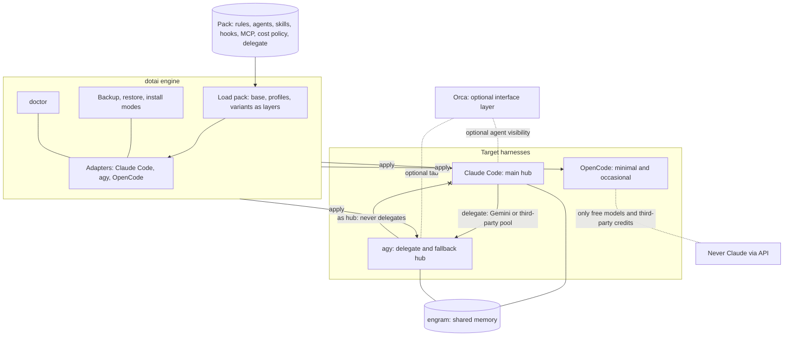
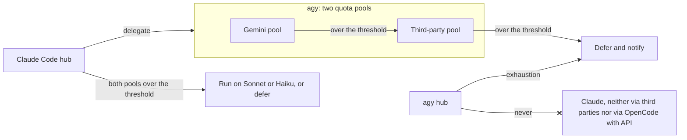
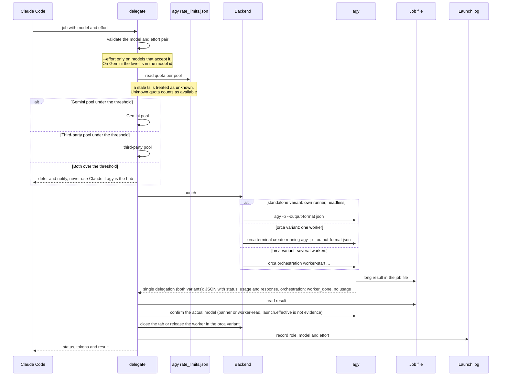
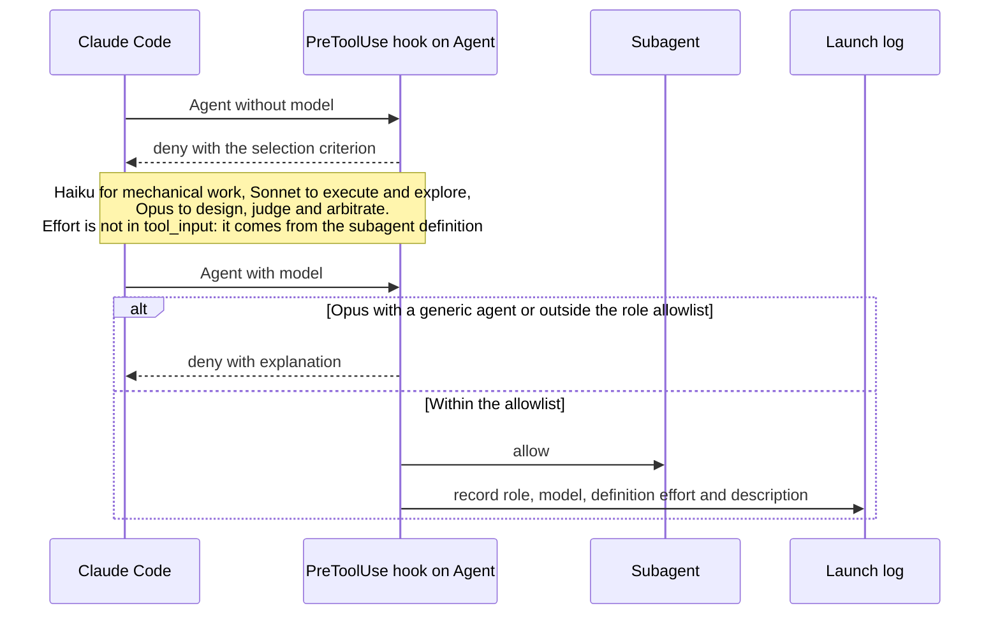
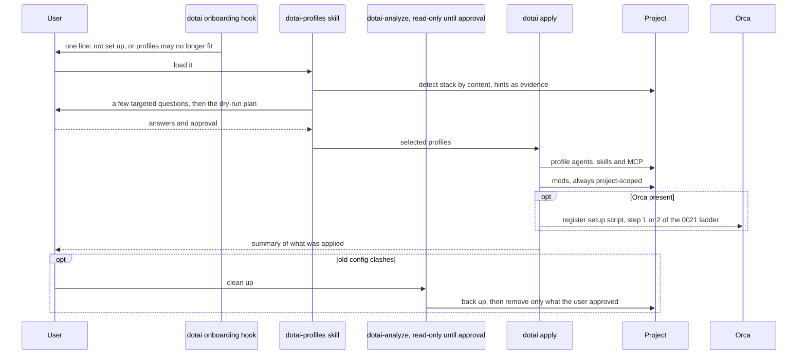
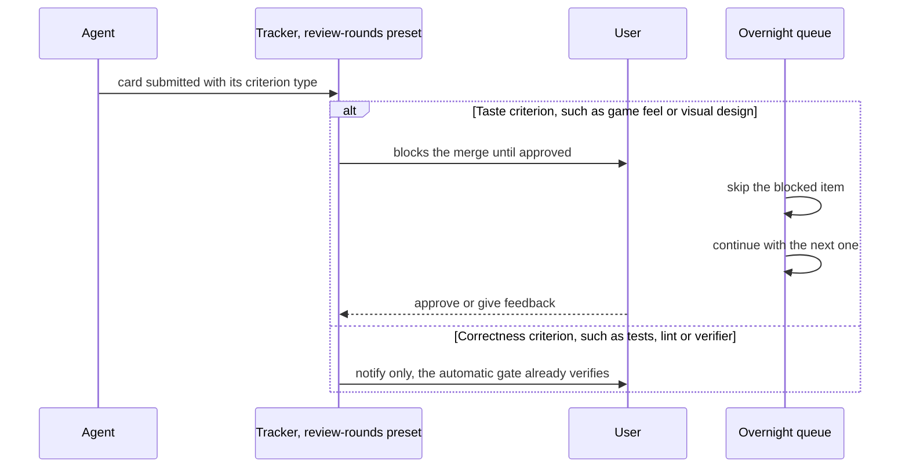
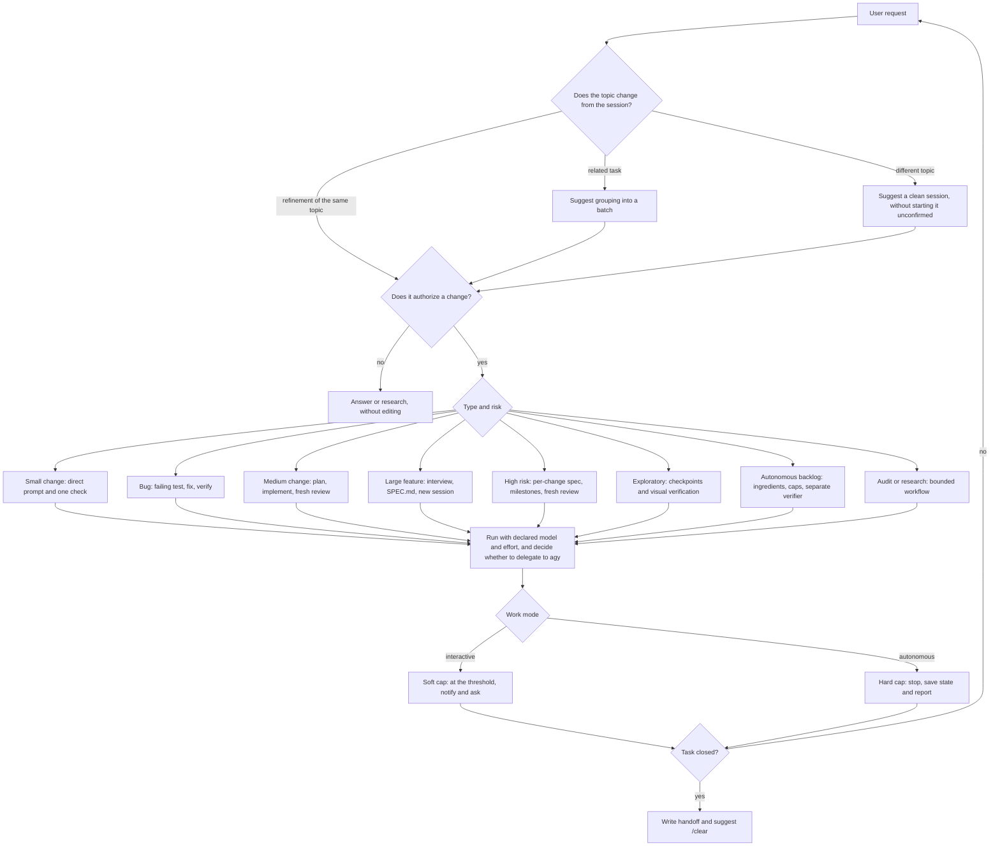

# Runtime

- **Status:** design, no code. Describes the planned runtime of the reference pack as decided.
- **verified-at:** 2026-11-01
- **covers:** [0008](decisions/0008-always-on-budget-values.md), [0009](decisions/0009-directional-delegation-with-quota-config.md), [0010](decisions/0010-onboarding-profile-classification.md), [0014](decisions/0014-base-principles-scripts-hooks-deny.md), [0016](decisions/0016-review-web-approval-by-criterion-type.md), [0017](decisions/0017-statusline-in-base.md), [0030](decisions/0030-explicit-model-and-effort-enforcement.md), [0019](decisions/0019-quota-cap-by-who-is-in-charge.md), [0020](decisions/0020-drop-sdd-lightweight-task-router.md), [0021](decisions/0021-orca-extend-dont-fork.md), [0022](decisions/0022-delegate-visible-orca-backend.md), [0023](decisions/0023-workflows-by-task-type-v2.md), [0024](decisions/0024-sessions-by-topic-clean-context.md), [0027](decisions/0027-review-rounds-preset-in-the-tracker.md), [0028](decisions/0028-standalone-and-orca-variants.md), [0029](decisions/0029-reference-pack-v1-scope.md), [0034](decisions/0034-delegate-packaging-base-tool-variant-runners.md), [0031](decisions/0031-orca-single-delegation-terminal-agy-p.md), [0032](decisions/0032-variant-parity-by-use-case.md), [0033](decisions/0033-coexist-with-orca-installed-skills.md), [0035](decisions/0035-task-router-refinements.md), [0036](decisions/0036-single-reviewer-by-focus.md), [0037](decisions/0037-base-subagent-roster.md), [0038](decisions/0038-base-bash-guards-ask-and-deny.md), [0039](decisions/0039-artifact-reads-guarded-by-size.md), [0040](decisions/0040-project-onboarding-and-on-demand-profiles.md), [0041](decisions/0041-engram-via-cli-and-hooks.md), [0042](decisions/0042-memory-save-policy.md)

This document is a map of how the reference pack behaves at runtime. The engine that installs it is described in [the engine's ARCHITECTURE.md](../../dotai/docs/ARCHITECTURE.md), and the format this pack follows in [PACK-FORMAT.md](../../dotai/docs/PACK-FORMAT.md). The why lives in the [decision records](decisions/README.md) and the detail in [DESIGN.md](DESIGN.md). Anything not yet decided is marked as pending and points to [OPEN-QUESTIONS.md](OPEN-QUESTIONS.md). Anything not stated by a source document is marked `(inferred)`.

## 1. Overview

The pack adds its own modules to the base (`delegate`, statusline, task router) and an onboarding step that detects the project's stack. Orca is an optional interface layer that the pack supports through a variant ([0028](decisions/0028-standalone-and-orca-variants.md)). Review cards live in an external tracker that the pack declares ([0027](decisions/0027-review-rounds-preset-in-the-tracker.md)).

Directional routing ([0009](decisions/0009-directional-delegation-with-quota-config.md)):

## 2. Source levels

What each source level contains ([DESIGN §3 and §4](DESIGN.md#3-global-base)):

| Level | Content | Always-on cost |
|---|---|---|
| **Base** | Core `AGENTS.md`, cost policy, task router ([0020](decisions/0020-drop-sdd-lightweight-task-router.md)), sessions-by-topic rule ([0024](decisions/0024-sessions-by-topic-clean-context.md)), `delegate` skill, hooks (`PreToolUse` on `Agent`, `timeout`, Bash guards that ask for destructive commands and filter denied paths, a size-based `Read` hook for artifacts), `permissions.deny` for secrets, `memory` skill and Engram hooks, statusline | Rules ≤ 2,500, listing ≤ ~2,000, total warn 4,000 in Claude Code and agy ([0046](decisions/0046-split-always-on-budget.md)) |
| **Profiles** (flat and combinable, [dotai 0023](../../dotai/docs/decisions/0023-flat-profiles-and-layer-merge-rules.md)) | `godot`, `autonomous-orchestra` (autonomous backlogs), `video` ([0040](decisions/0040-project-onboarding-and-on-demand-profiles.md)), `web`, `astro-cloudflare`, `next-vercel-supabase`, `seo`, `desktop`, `tooling` and per-stack tooling profiles; final list is reference pack content | `web` ~1.1k, `godot` 1–3k, `tooling` ≤0.7k, `desktop` ≤0.5k |
| **Modules** | `delegate`, guards, panel, clash cleanup (`dotai-analyze`); per [dotai 0004](../../dotai/docs/decisions/0004-installer-language-and-shape.md), opt-in | On demand |

Pending:

- Headless agy is a viable hub ([0043](decisions/0043-v1-is-the-complete-pack.md), update 2026-11-02); how a headless hub learns its quota is still open: [OPEN-QUESTIONS, measurement 1](OPEN-QUESTIONS.md).
- Stability of the mods API for the panel: [OPEN-QUESTIONS, measurement 12](OPEN-QUESTIONS.md).

## 3. Runtime

### 3.a `delegate` from Claude Code to agy

Validated in [0022](decisions/0022-delegate-visible-orca-backend.md). The reference pack declares two variants ([0028](decisions/0028-standalone-and-orca-variants.md)): `standalone`, where its own backend launches; and `orca`, where Orca launches, waits and closes (an Orca terminal running `agy -p` for a single delegation, [0031](decisions/0031-orca-single-delegation-terminal-agy-p.md); `orca orchestration` for several workers) and the pack only adds its contract. The engine knows nothing about Orca; it only applies the chosen variant as a layer. Packaging ([0034](decisions/0034-delegate-packaging-base-tool-variant-runners.md), engine answers in its 2026-11-01 update): one backend-agnostic `delegate` skill and one shared contract tool in the base, `delegate-core.mjs` (a library the backends import, with no wrapper; 0034 update 2026-11-03), and one backend tool per variant named `delegate-backend` (there is no `runners/` directory). In both variants, the pack's base tool validates the model/effort pair beforehand and confirms the actual model afterwards, because Orca's `launch.effective` is not evidence. The current runner's "use Claude" rejection is inverted per [0009](decisions/0009-directional-delegation-with-quota-config.md): when agy is the hub, exhausting the pools defers and notifies.

Quota freshness: `rate_limits.json` is written only while an interactive agy session with the statusline runs ([0022](decisions/0022-delegate-visible-orca-backend.md)), so a headless `standalone` delegation will often find a stale `ts`, which counts as unknown. Unknown quota counts as available; exhaustion is detected by the quota error from `agy -p`, which marks the pool exhausted for the run ([0022, update 2026-10-26](decisions/0022-delegate-visible-orca-backend.md#update-2026-10-26-unknown-quota-counts-as-available)).

Visibility in v1: in `standalone`, a live viewer of the subagent tree read from the launch log, in a side terminal ([0032](decisions/0032-variant-parity-by-use-case.md)), plus the statusline's `delegate:` line and the launch log ([0030](decisions/0030-explicit-model-and-effort-enforcement.md)); the base `Agent` hook appends Claude Code subagent launches to the same log, so the viewer shows one tree; the panel named in [0028](decisions/0028-standalone-and-orca-variants.md) comes after v1 ([0029](decisions/0029-reference-pack-v1-scope.md)). In `orca`, Orca shows the delegation as a child agent or tab.

### 3.b Subagent launch under the strict hook

Decided in [0030](decisions/0030-explicit-model-and-effort-enforcement.md): in Claude Code effort cannot be set per launch, so the hook requires `model` and effort comes from the subagent definition ([dotai 0024](../../dotai/docs/decisions/0024-models-declared-per-harness-no-tiers.md), [HARNESS-NOTES](../../dotai/docs/HARNESS-NOTES.md)). The hook guarantees the model is present; the log measures the quality of the choice.

Safety net for paths the hook does not cover: `CLAUDE_CODE_SUBAGENT_MODEL=sonnet`.

### 3.c Project onboarding

Decided in [0010](decisions/0010-onboarding-profile-classification.md) and [0040](decisions/0040-project-onboarding-and-on-demand-profiles.md) (the pack backs up affected files before cleaning clashes) and [0047](decisions/0047-adopt-dotai-owned-onboarding.md) (dotai's own session-start hook and `dotai-profiles` skill choose the profiles, [dotai 0045](../../dotai/docs/decisions/0045-dotai-owned-project-onboarding.md); a task that needs a missing profile loads `dotai-profiles`); shape in [DESIGN §4.5](DESIGN.md#45-onboarding-layer-4). Mods are always installed at project level (invariant, see §5).

Registering the setup script in Orca is optional and its exact form (`orca.yaml` or the `orca` CLI) is not defined (inferred from [0021](decisions/0021-orca-extend-dont-fork.md): configuration, then external integration).

### 3.d Approval in review cards

Rules from [0016](decisions/0016-review-web-approval-by-criterion-type.md), applied by the `review-rounds` preset of the external tracker ([0027](decisions/0027-review-rounds-preset-in-the-tracker.md)).

## 4. Task router

Classification in the base and one skill per type ([0020](decisions/0020-drop-sdd-lightweight-task-router.md), [0023](decisions/0023-workflows-by-task-type-v2.md)). Sessions-by-topic rule in [0024](decisions/0024-sessions-by-topic-clean-context.md). Quota caps in [0019](decisions/0019-quota-cap-by-who-is-in-charge.md).

The hard threshold is configuration of the base `delegate` tool at user scope ([0034](decisions/0034-delegate-packaging-base-tool-variant-runners.md)) and is changed only by editing that configuration, never from the chat ([0019](decisions/0019-quota-cap-by-who-is-in-charge.md)). The full verification and cap table per type is in [0023](decisions/0023-workflows-by-task-type-v2.md).

## 5. Invariants

- agy as hub never delegates to Claude, neither directly, nor via its third-party pool, nor via OpenCode with API. Exhaustion is resolved by deferring and notifying ([0009](decisions/0009-directional-delegation-with-quota-config.md)).
- No silent inheritance ([0030](decisions/0030-explicit-model-and-effort-enforcement.md)): every Claude Code delegation declares `model` (the hook rejects it otherwise) and effort is fixed in each pack subagent's definition (agents without a declared effort, generic built-ins included, are rejected); every `delegate` job declares model and effort, validated as a pair ([0022](decisions/0022-delegate-visible-orca-backend.md)).
- Quota thresholds and the preferred pool are configuration of the base `delegate` tool at user scope, not chat and not profile content ([0034](decisions/0034-delegate-packaging-base-tool-variant-runners.md)). Soft cap in interactive mode, hard cap in autonomous mode ([0019](decisions/0019-quota-cap-by-who-is-in-charge.md)).
- Mods are installed per project, never at user level ([dotai 0011](../../dotai/docs/decisions/0011-mods-always-project-scoped.md)). The panel, after v1 ([0029](decisions/0029-reference-pack-v1-scope.md)), has per-project extension sections ([DESIGN §7](DESIGN.md#7-delegate-and-quota-routing)).
- Always-on budget, real tokens, both harnesses: rules ≤ 2,500, listing ≤ ~2,000 (≤ ~100 per entry), total warn 4,000 and fail 5,000, measured by `dotai doctor` (engine question). ([0046](decisions/0046-split-always-on-budget.md))
- Scripts and CLI before MCP; policy in config and hooks, not in prompt text. ([0014](decisions/0014-base-principles-scripts-hooks-deny.md))
- Review cards live in an external tracker consumed through the pack; it runs locally and works with agy as hub and without internet ([0027](decisions/0027-review-rounds-preset-in-the-tracker.md)).
- dotai does not depend on Orca: the `standalone` variant's headless backend always works ([0022](decisions/0022-delegate-visible-orca-backend.md), [0028](decisions/0028-standalone-and-orca-variants.md)). Orca is not forked ([0021](decisions/0021-orca-extend-dont-fork.md)).
- SDD is not installed, not even on demand ([0020](decisions/0020-drop-sdd-lightweight-task-router.md)).

## 6. Boundaries and external integrations

The pack does not control these surfaces: it uses them and can break if they change. Verified harness facts are in the engine's [HARNESS-NOTES.md](../../dotai/docs/HARNESS-NOTES.md).

| System | What the pack uses | Source and notes |
|---|---|---|
| **Claude Code** | Hooks (`PreToolUse` on `Agent`, `Bash` and `Read`; `Stop`; `SessionStart`; `PreCompact`), `statusLine`, `permissions.deny` (secrets; a Read deny also blocks the Bash file commands Claude Code recognizes, [0038](decisions/0038-base-bash-guards-ask-and-deny.md)), mods (panel), variables such as `CLAUDE_CODE_SUBAGENT_MODEL` | [DESIGN §3](DESIGN.md#3-global-base), [0030](decisions/0030-explicit-model-and-effort-enforcement.md) |
| **agy** | `agy -p --output-format json`, `--model`, `--effort` (only where the model supports it), `--json-schema`, `agy models`; quotas in `~/.gemini/antigravity-cli/rate_limits.json` (`gemini_5h_pct`, `gemini_7d_pct`, `p3_5h_pct`, `p3_7d_pct`, `ts`, written by the statusline) | [0022](decisions/0022-delegate-visible-orca-backend.md). Limits: encoding bug in `-p` (worked around with a job file); agy hooks unverified |
| **Orca** (optional) | `orca terminal create` (running `agy -p`, [0031](decisions/0031-orca-single-delegation-terminal-agy-p.md)), `orca orchestration`, `orca terminal wait`/`read`/`close` (`orca` variant of the reference pack, [0028](decisions/0028-standalone-and-orca-variants.md)); `orca skills get <x>` pattern | [0021](decisions/0021-orca-extend-dont-fork.md), [0022](decisions/0022-delegate-visible-orca-backend.md). Ladder: configuration, external integration, upstream issue or PR, minimal patch |
| **engram** | Shared memory from Claude Code to agy, through its pinned CLI and a `memory` skill (no MCP); the session summary is saved by a `PreCompact` hook and `SessionStart` injects preferences and pinned items, capped | [0005](decisions/0005-engram-as-memory-backend.md), [0041](decisions/0041-engram-via-cli-and-hooks.md), [0042](decisions/0042-memory-save-policy.md), [DESIGN §5](DESIGN.md#5-memory-and-code-intelligence). Open risks on Windows |
| **gh** | CLI instead of the GitHub MCP | [DESIGN §2, P1](DESIGN.md#2-cross-cutting-principles) (backed by [0014](decisions/0014-base-principles-scripts-hooks-deny.md)) |
| **OpenCode** | Minimal and occasional target; third-party API credits | [0009](decisions/0009-directional-delegation-with-quota-config.md). Pi was evaluated and not adopted (no subagents, no permission model; [0009](decisions/0009-directional-delegation-with-quota-config.md), update 2026-11-02) |

## Maintenance

Review this file when a decision listed in `covers` changes or pack content appears.
